<picture>
  <source media="(prefers-color-scheme: dark)" srcset="assets/dev-pc-list-dark.png">
  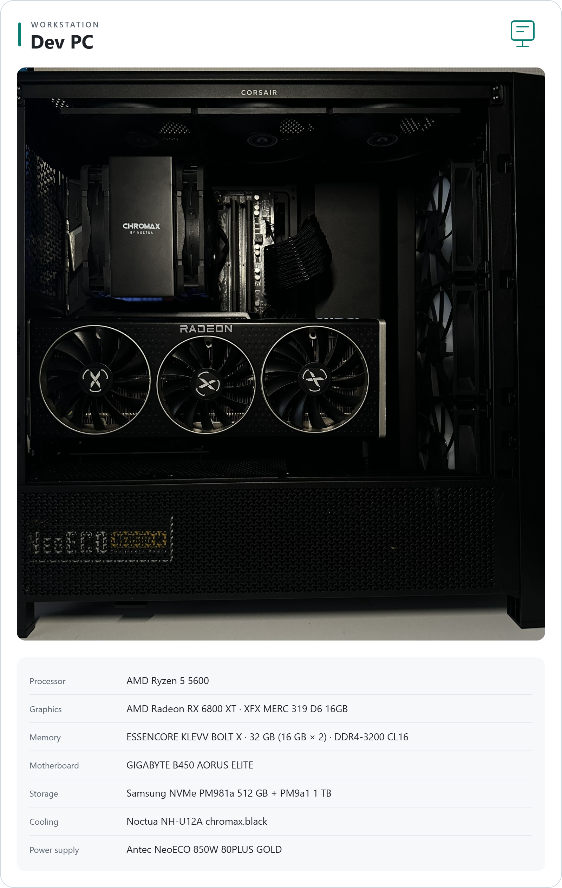
</picture>

<picture>
  <source media="(prefers-color-scheme: dark)" srcset="assets/nas-list-dark.png">
  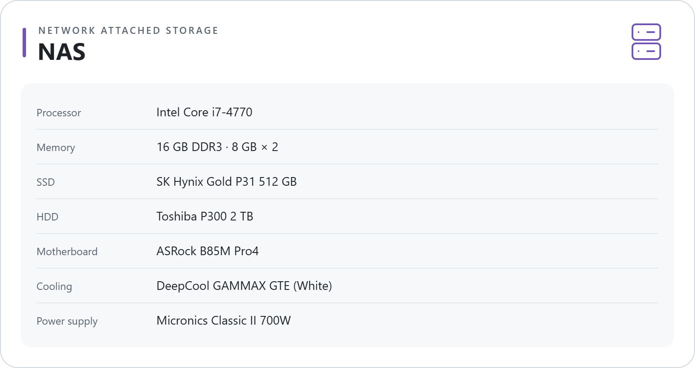
</picture>

<a href="https://metrics.lecoq.io/insights?user=rdme0">
  <picture>
    <source media="(prefers-color-scheme: dark)" srcset="assets/github-metrics-dark.png">
    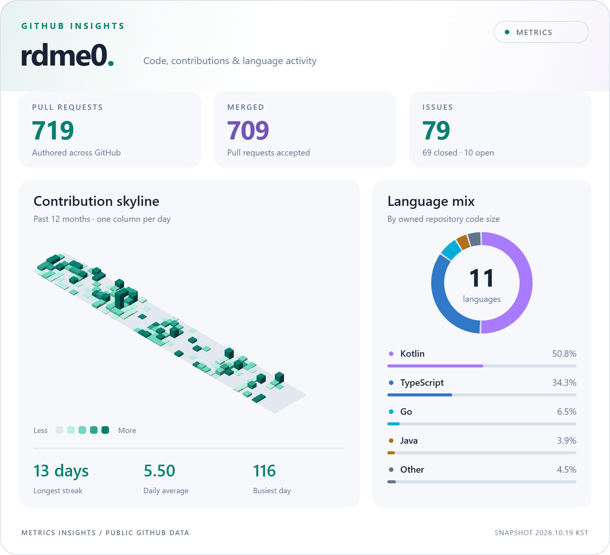
  </picture>
</a>

## 🛠️ Skills
<!-- Glass icons: scripts/render_skills.py -->

### Languages

**Hands-on Experience**

  <picture>
    <source media="(prefers-color-scheme: dark)" srcset="assets/skills/kotlin-glass-dark.png">
    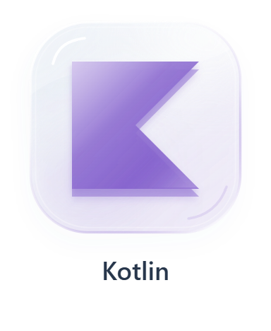
  </picture>
  <picture>
    <source media="(prefers-color-scheme: dark)" srcset="assets/skills/java-glass-dark.png">
    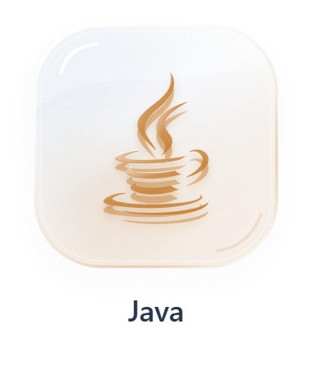
  </picture>
  <picture>
    <source media="(prefers-color-scheme: dark)" srcset="assets/skills/go-glass-dark.png">
    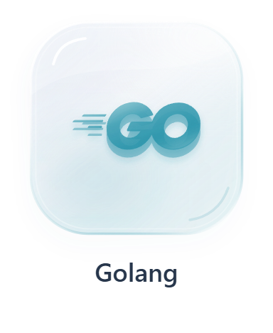
  </picture>

**Basic Knowledge**

  <picture>
    <source media="(prefers-color-scheme: dark)" srcset="assets/skills/python-glass-dark.png">
    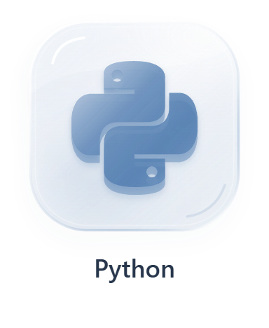
  </picture>
  <picture>
    <source media="(prefers-color-scheme: dark)" srcset="assets/skills/cplusplus-glass-dark.png">
    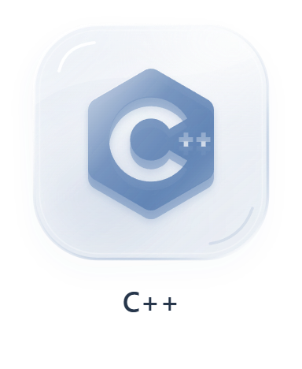
  </picture>
  <picture>
    <source media="(prefers-color-scheme: dark)" srcset="assets/skills/javascript-glass-dark.png">
    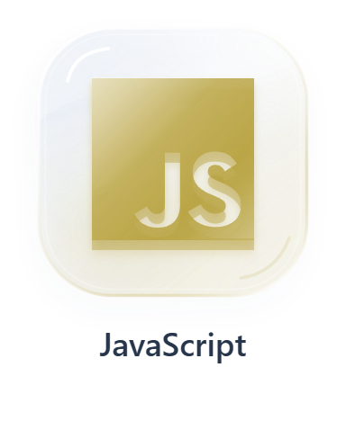
  </picture>
  <picture>
    <source media="(prefers-color-scheme: dark)" srcset="assets/skills/typescript-glass-dark.png">
    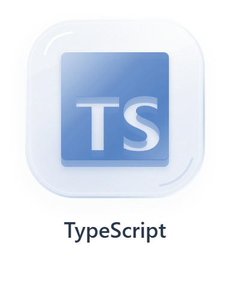
  </picture>

### Frameworks & Libraries

  <picture>
    <source media="(prefers-color-scheme: dark)" srcset="assets/skills/springboot-glass-dark.png">
    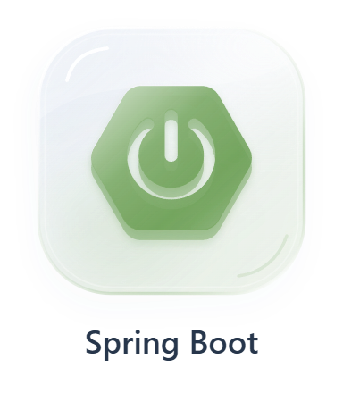
  </picture>
  <picture>
    <source media="(prefers-color-scheme: dark)" srcset="assets/skills/jpa-glass-dark.png">
    
  </picture>
  <picture>
    <source media="(prefers-color-scheme: dark)" srcset="assets/skills/coroutines-glass-dark.png">
    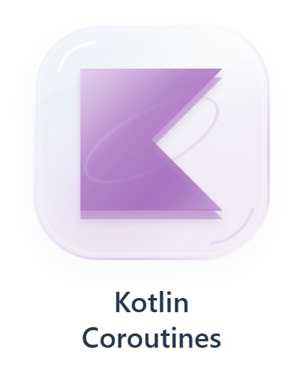
  </picture>
  <picture>
    <source media="(prefers-color-scheme: dark)" srcset="assets/skills/gin-glass-dark.png">
    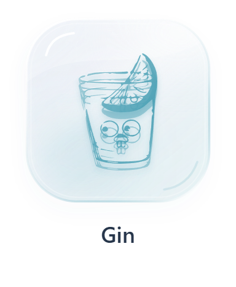
  </picture>

### Infrastructure

  <picture>
    <source media="(prefers-color-scheme: dark)" srcset="assets/skills/docker-glass-dark.png">
    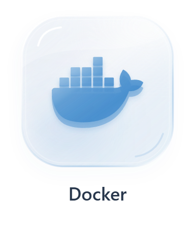
  </picture>
  <picture>
    <source media="(prefers-color-scheme: dark)" srcset="assets/skills/nginx-glass-dark.png">
    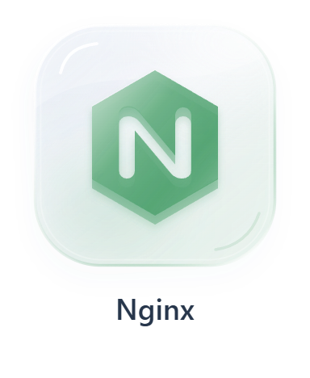
  </picture>
  <picture>
    <source media="(prefers-color-scheme: dark)" srcset="assets/skills/aws-ec2-glass-dark.png">
    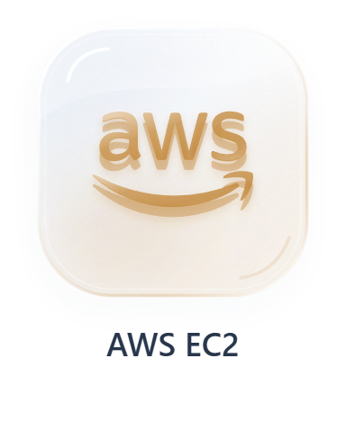
  </picture>
  <picture>
    <source media="(prefers-color-scheme: dark)" srcset="assets/skills/aws-s3-glass-dark.png">
    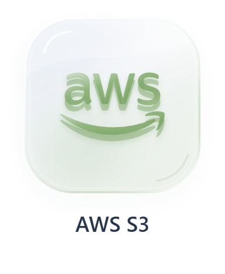
  </picture>
  <picture>
    <source media="(prefers-color-scheme: dark)" srcset="assets/skills/aws-ses-glass-dark.png">
    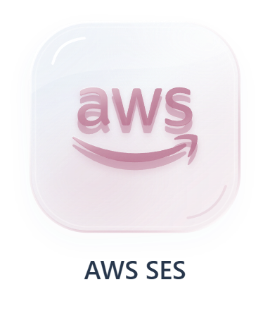
  </picture>
  <picture>
    <source media="(prefers-color-scheme: dark)" srcset="assets/skills/cloudflare-glass-dark.png">
    
  </picture>
  <picture>
    <source media="(prefers-color-scheme: dark)" srcset="assets/skills/grafana-glass-dark.png">
    
  </picture>

### Databases

  <picture>
    <source media="(prefers-color-scheme: dark)" srcset="assets/skills/postgresql-glass-dark.png">
    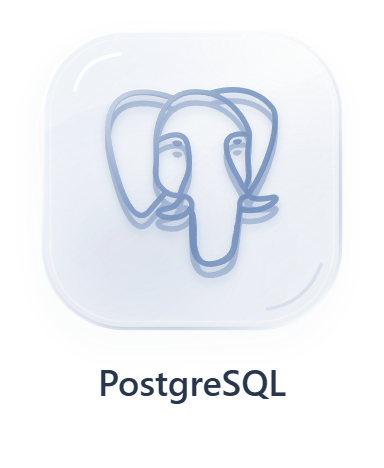
  </picture>
  <picture>
    <source media="(prefers-color-scheme: dark)" srcset="assets/skills/mysql-glass-dark.png">
    
  </picture>
  <picture>
    <source media="(prefers-color-scheme: dark)" srcset="assets/skills/sqlite-glass-dark.png">
    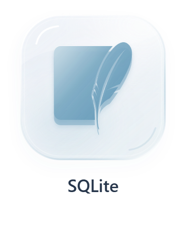
  </picture>
  <picture>
    <source media="(prefers-color-scheme: dark)" srcset="assets/skills/redis-glass-dark.png">
    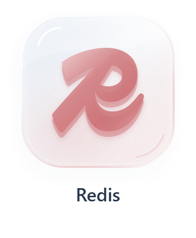
  </picture>
  <picture>
    <source media="(prefers-color-scheme: dark)" srcset="assets/skills/flyway-glass-dark.png">
    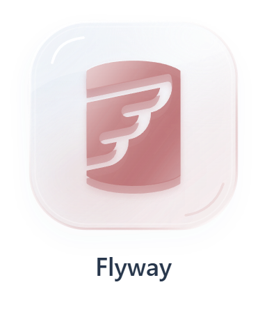
  </picture>

### Communication Protocols

  <picture>
    <source media="(prefers-color-scheme: dark)" srcset="assets/skills/websocket-glass-dark.png">
    
  </picture>
  <picture>
    <source media="(prefers-color-scheme: dark)" srcset="assets/skills/grpc-glass-dark.png">
    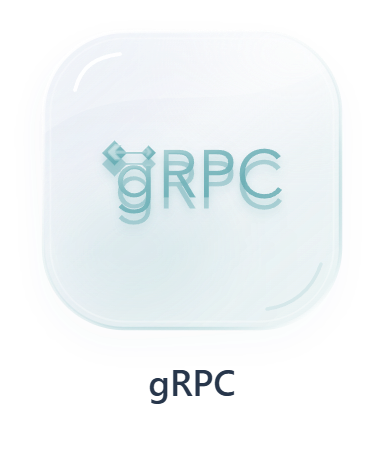
  </picture>
  <picture>
    <source media="(prefers-color-scheme: dark)" srcset="assets/skills/http-sse-glass-dark.png">
    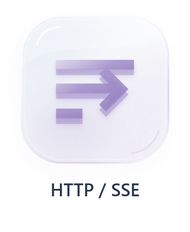
  </picture>

### Design

  <picture>
    <source media="(prefers-color-scheme: dark)" srcset="assets/skills/figma-glass-dark.png">
    
  </picture>

